# BreatheCare 🌿

A peaceful, nature-inspired breathing & wellness app built with Flutter (Android & iOS).
Free, ad-supported (Google AdMob), English + Hindi, light & dark themes, and fully usable offline.

> BreatheCare is a relaxation / wellness app. It is **not** a medical device and makes no medical claims.

| Home | Home (more) | Home (dark) |
| --- | --- | --- |
| 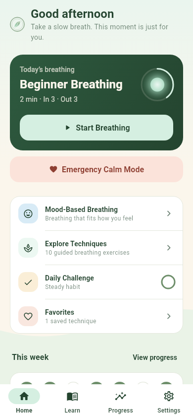 | 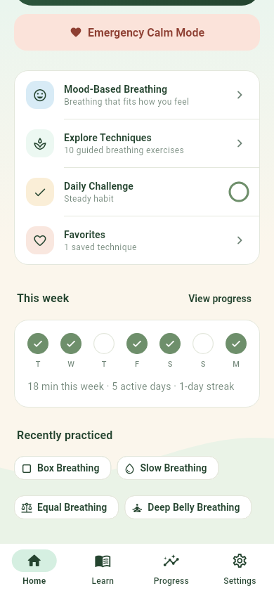 |  |
| **Guided session** | **Session (dark)** | **Settings** |
| 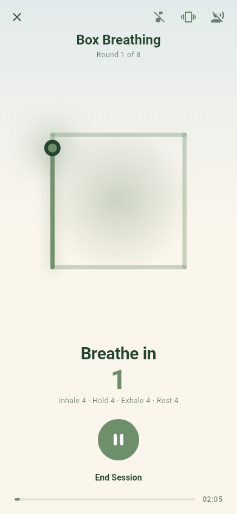 |  | 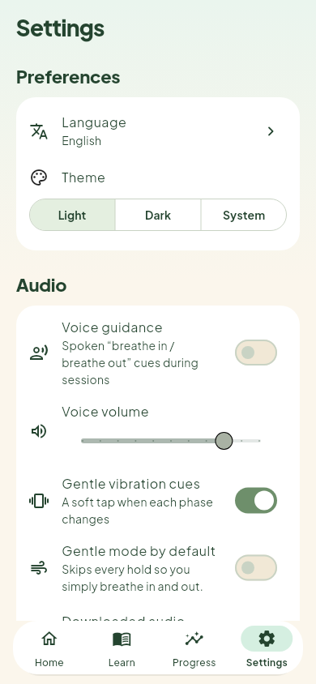 |
| **Music** | **Music categories** | **Music player** |
| 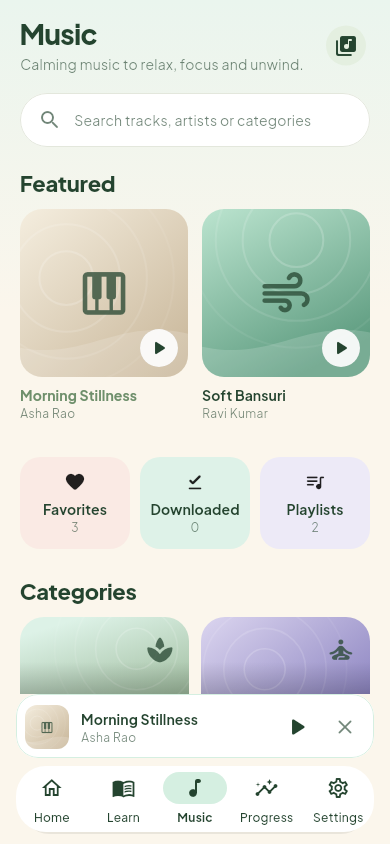 | 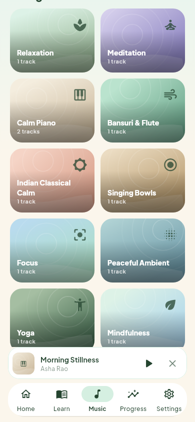 | 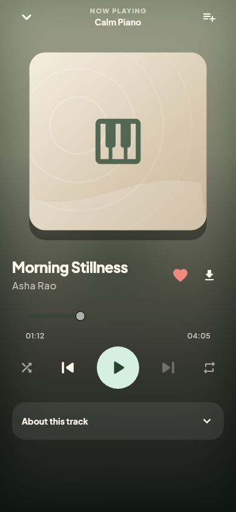 |
| **Music category** | **My Music** | **Music (dark)** |
| 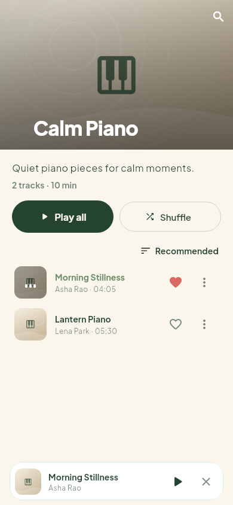 | 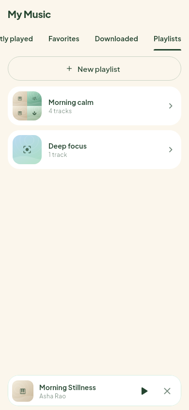 | 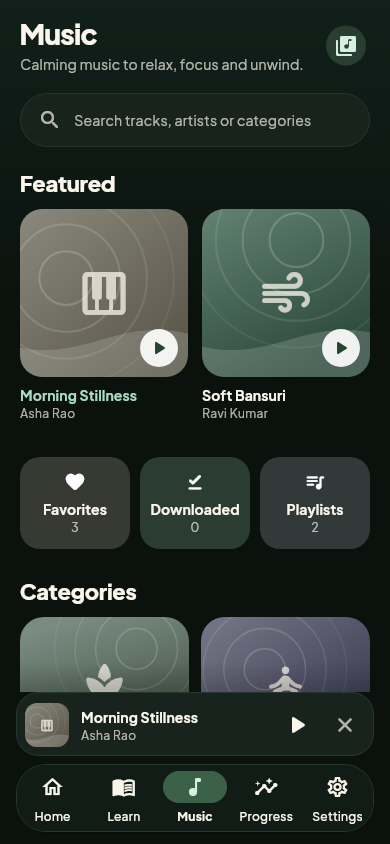 |
| **Techniques** | **Progress** | **Daily Challenges** |
| 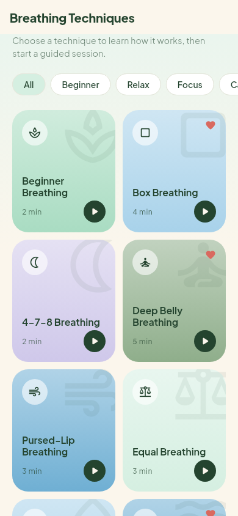 | 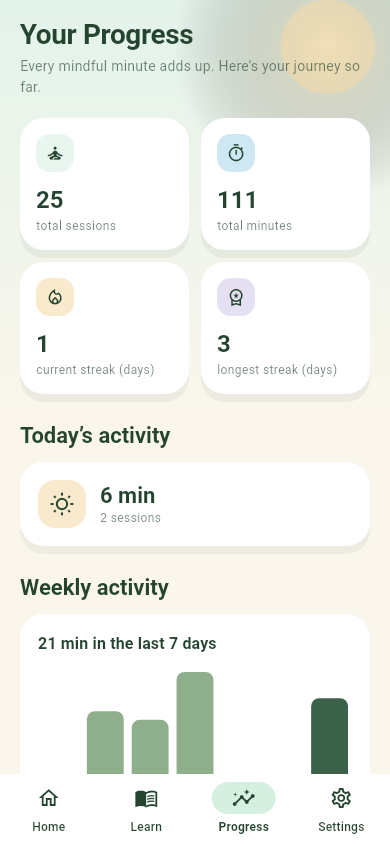 | 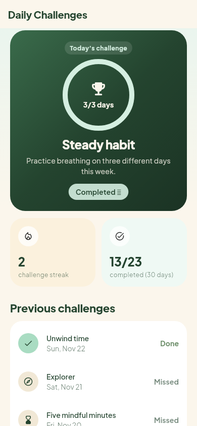 |

<sub>Screenshots are rendered from widget tests.</sub>

## Features

| Area | What's included |
| --- | --- |
| **Home** | Greeting, today's suggested technique with daily-goal ring, **Start Breathing**, **Emergency Calm Mode**, Explore / Mood / Daily Challenge / Favorites shortcuts, today's challenge, recently practiced, weekly summary |
| **Techniques** | 10 techniques (Beginner, Box, 4-7-8, Deep Belly, Pursed-Lip, Equal, Slow, Resonant, Gentle Relaxation, Focus) — each with description, benefits & purpose, steps, recommended duration, duration picker, live rhythm preview, audio guidance and **Start Practice** |
| **Guided session** | Animated lotus visual that grows/shrinks with the breath, Inhale / Hold (only where appropriate) / Exhale, phase countdown, elapsed & remaining time, Pause/Resume, End Session, optional voice guidance (on-device TTS, works offline), haptic cues, keeps screen awake, auto-pauses when the app is backgrounded. **Gentle mode** removes every breath hold. |
| **Mood-Based Breathing** | “How are you feeling right now?” popup with 8 moods → a page of suitable techniques with an explanation and Start Breathing button. Mood is never stored. |
| **Daily Challenges** | 7 rotating challenges, progress ring, completion status, challenge streak, 30-day completion rate, history of previous days. Computed from local history → works offline. |
| **Emergency Calm Mode** | Starts instantly, simple 4-in / 6-out breathing (no holds), large visual, reassuring rotating messages, “Shorter breaths” option, big **Stop** button, medical-help disclaimer, offline, never shows ads. |
| **Explore** | ~50 bilingual pages in 6 sections: **Yoga asanas** (Tadasana, Vrikshasana, Bhujangasana, Surya Namaskar …), **Pranayama & breath tricks** (Anulom-Vilom, Bhramari, Ujjayi, Sheetali …), **Calm & stress relief**, **Herbs & kitchen wisdom** (haldi, tulsi, adrak, ashwagandha … each with a safety note), **Better lifestyle**, and the original **breathing guides**. Search (English or Hindi), category chips, pick of the day. Yoga/pranayama cards have a **Watch on YouTube** button that opens a YouTube search for that pose. |
| **Reminders** | Optional morning (default 8:00 AM) and evening wind-down (default 9:00 PM) local notifications with a different message each weekday — breathing, yoga, herbs, energize or sleep music. Tapping one opens the matching screen. Offered once on the second day of use; change or turn off in Settings. Works offline. |
| **Progress** | Total sessions/minutes, current & longest streak, today, weekly bar chart, 4-week activity heat-map, challenge completion, most practiced techniques, full session history. |
| **Favorites** | Heart any technique; dedicated Favorites screen. |
| **Audio guidance** | MP3s downloaded once from Firebase Storage, stored on device, played offline. Download progress, downloaded badge, retry, cancel, delete, delete-all, storage used. Player: Play/Pause, Replay, seek bar. |
| **Account (optional)** | Invited after ~10 days of use (max twice). User ID + PIN, Login / Create Account / Maybe Later. Back up & restore progress (Firestore). The app never requires login. |
| **Settings** | English / हिन्दी, Light / Dark / System theme, voice guidance & volume, haptics, gentle-mode default, downloaded audio management, account, Privacy Policy, Terms, About, ad privacy choices (when required), **Delete My Data**. |

## Listen tab

A dedicated **Listen** tab (2nd in the tab bar: Home · Listen · Explore · Progress · Settings) with:

- **Library:** featured tracks, 17 categories (each opens its own page), search by title / artist / category, category filters and sorting (Recommended, A–Z, artist, shortest, longest, newest).
- **Player:** full-screen player with cover art, title and artist, play/pause, next/previous, seek bar with times, shuffle, repeat (off / all / one), favorite, download, add to playlist, and "About this track".
- **Mini player:** persistent above the tab bar (and on music pages), with cover, title, play/pause and close. Tap it to open the full player.
- **Background playback:** music keeps playing across tabs, with the screen locked, and from the notification / lock-screen media controls (`just_audio_background`).
- **Saved as you listen:** the first time a track plays it is streamed *and* saved to the phone at the same time (`LockCachingAudioSource`), so it is never downloaded from the server again and plays offline. Can be turned off in Settings → "Save music as you listen".
- **Downloads:** one-time download into app storage, with progress, a saved indicator, cancel, retry and delete. Saved tracks play offline.
- **My Music:** Recently played, Favorites, Downloaded and Playlists (create, rename, delete, reorder, add/remove tracks).
- **Memory:** remembers the last track and position (for tracks longer than 3 minutes), plus shuffle and repeat.
- **Offline:** the catalog and cover images are cached on the device. If a track can't be reached, the app says so and skips it.

Breathing-guidance audio uses the same player, so it also gets background playback and lock-screen controls.

### Categories (use these ids in `catalog.json`)

| id | Name | id | Name |
| --- | --- | --- | --- |
| `relaxation` | Relaxation | `stress` | Stress Relief |
| `sleep` | Sleep & Rest | `energy` | Energize |
| `meditation` | Meditation | `focus` | Focus |
| `guided` | Guided Meditation | `ambient` | Peaceful Ambient |
| `piano` | Calm Piano | `yoga` | Yoga |
| `instrumental` | Instrumental | `mindfulness` | Mindfulness |
| `flute` | Bansuri & Flute | `morning` | Gentle Morning |
| `indian` | Indian Classical Calm | `short` | Short Relaxation (also shows every track ≤ 5 min) |
| `bowls` | Singing Bowls | | |

Categories only appear once they contain at least one track. Names, descriptions and colors live in `lib/data/music_categories.dart`.

### Uploading music to Firebase Storage

1. **Configure Firebase** (see *Getting started → Firebase* below) and deploy `storage.rules`. It makes everything under `music/` public read-only and blocks writes from the app.
2. **Prepare files:**
   - **Audio:** MP3, 44.1 kHz, 128–192 kbps (about 1–1.5 MB per minute). Normalise loudness so tracks play at a similar volume (around −16 LUFS).
   - **Covers:** square JPG/PNG/WebP, 800×800 px, under 300 KB. Optional category covers go in `music/covers/categories/<category-id>.jpg`. Without a cover, the app draws a nature-style cover in the category colors.
   - **File names:** lowercase, with hyphens, e.g. `morning-stillness.mp3`.
3. **Create `catalog.json`** — the list of tracks the app shows. Start from `docs/music/catalog.example.json`, or generate it:
   ```bash
   pip install mutagen   # optional: reads durations automatically
   python3 tools/make_music_catalog.py my_music --artist "Your Name" > catalog.json
   ```
   Fields: `id` (unique), `title` (+ optional `title_hi`), `artist`, `category`, `duration` (seconds), `description` (+ optional `description_hi`), `audio`, `cover` (optional), `added` (YYYY-MM-DD), `featured` (true/false).
4. **Upload**, keeping this layout:
   ```
   music/
     catalog.json
     audio/<id>.mp3
     covers/<id>.jpg
     covers/categories/<category-id>.jpg   (optional)
   ```
   - **Easiest — Firebase Console:** open your project → **Storage** → create the `music` folder and its `audio` and `covers` subfolders → **Upload file** (you can drag several at once) → upload `catalog.json` into `music/`.
   - **Command line** (Google Cloud SDK):
     ```bash
     gsutil -m cp -r music gs://<your-project>.appspot.com/
     ```
     The bucket name is shown at the top of the Storage page.
5. **To add or change tracks later,** upload the new files and the updated `catalog.json`. The app downloads the latest catalog every time it opens, or when you pull down to refresh on the Music tab.

### Music licensing

Only upload music you own or are licensed to **distribute inside an app as downloadable/streamed tracks**. Many "free" libraries forbid exactly that:

- **Pixabay** prohibits distributing its (non-CC0) audio "on a standalone basis", which is what a music library does ([license](https://pixabay.com/en/service/license/), [terms](https://pixabay.com/en/service/terms/)).
- **Royalty-free stores** usually allow use *inside* an app but not redistribution of the raw files. Some charge extra for music used without voice-over (e.g. [MeditationMusicLibrary](https://meditationmusiclibrary.com/collections/piano)). Read the clause on apps and redistribution, or ask for an app/streaming license ([TunePocket's guide](https://www.tunepocket.com/how-to-properly-license-music-for-your-meditation-relaxation-or-sleep-app/)).
- **Safer options:**
  - Commission or produce your own music (you own it).
  - License from a library that explicitly allows meditation/wellness apps.
  - Use CC0 tracks.
  - Use CC BY tracks, crediting the artist in `artist`/`description` as the license requires.
  - Use **public-domain compositions** (e.g. Satie, Debussy) only in a recording you own or that is itself released as public domain or CC0. The *recording* has its own copyright.

## Advertising rules (enforced in `lib/services/ads_service.dart`)

* Only small, labelled **banner** ads (Home, All Techniques, Explore, Listen, Progress). No interstitial / full-screen ads.
* Ads are **suppressed** (banners disposed) whenever a breathing session or Emergency Calm Mode is open.
* All requests are `nonPersonalizedAds: true`, with no keywords — mood/wellness data is never used for targeting. Content rating is capped at **G**.
* Google UMP consent is requested where legally required; “Ad privacy choices” appears in Settings when needed.

## Getting started

```bash
flutter pub get
flutter run
```

The app runs immediately with Google's **test** ad units and without Firebase (cloud features then show a friendly “not available” message; everything else works offline).

### 1. AdMob

1. Create the app and a **Banner** ad unit in [AdMob](https://apps.admob.com).
2. Put your **ad unit IDs** in `lib/config/ad_config.dart`.
3. Put your **App IDs** in:
   * `android/app/src/main/AndroidManifest.xml` → `com.google.android.gms.ads.APPLICATION_ID`
   * `ios/Runner/Info.plist` → `GADApplicationIdentifier`
4. Debug builds always use Google's test ads.
5. (Recommended) add your full SKAdNetwork list to `Info.plist` from Google's docs, and create a GDPR message in AdMob › Privacy & messaging.

### 2. Firebase (login, backup, audio downloads)

```bash
dart pub global activate flutterfire_cli
flutterfire configure --out=lib/config/firebase_options.dart
```


In the Firebase console:

* **Authentication** → enable the **Email/Password** provider (User IDs are mapped internally to `<userid>@users.breathecare.app`; no real e-mail is collected).
* **Firestore** → create a database and deploy `firestore.rules`.
* **Storage** → deploy `storage.rules` and upload your MP3s to the `guidance/` folder using these names:

| Technique | File |
| --- | --- |
| Beginner Breathing | `guidance/beginner.mp3` |
| Box Breathing | `guidance/box.mp3` |
| 4-7-8 Breathing | `guidance/478.mp3` |
| Deep Belly Breathing | `guidance/belly.mp3` |
| Pursed-Lip Breathing | `guidance/pursed.mp3` |
| Equal Breathing | `guidance/equal.mp3` |
| Slow Breathing | `guidance/slow.mp3` |
| Resonant Breathing | `guidance/resonant.mp3` |
| Gentle Relaxation Breathing | `guidance/relax.mp3` |
| Focus Breathing | `guidance/focus.mp3` |

### 3. Download an APK from GitHub Actions

The **Build APK** workflow runs **only when you start it** (pushing code never triggers a build):

1. Open the repository on GitHub → **Actions** → **Build APK** → **Run workflow**.
2. Pick the branch, `release` or `debug`, and optionally *split per ABI* for smaller APKs.
3. When it finishes (~10 min), download the APK from **Artifacts** at the bottom of the run page (a zip containing the `.apk`).

Without signing secrets the release APK is signed with a debug key — fine for installing on your phone, but not for Google Play. To sign with your own key, create one:

```bash
keytool -genkey -v -keystore upload-keystore.jks -keyalg RSA -keysize 2048 -validity 10000 -alias upload
base64 -w0 upload-keystore.jks   # copy the output
```

and add repository secrets (**Settings → Secrets and variables → Actions**): `ANDROID_KEYSTORE_BASE64`, `ANDROID_KEYSTORE_PASSWORD`, `ANDROID_KEY_ALIAS`, `ANDROID_KEY_PASSWORD`. Keep the `.jks` file safe — you need the same key for every Play Store update.

### 4. Release

* Android: set your own `applicationId` in `android/app/build.gradle.kts` and a release signing config.
* iOS: set your bundle id / team in Xcode, then `cd ios && pod install`.

## Project structure

```
lib/
  main.dart, app.dart          app bootstrap, providers, theming, localization
  config/                      AdMob + Firebase configuration
  data/                        techniques, moods, challenges, articles, legal text (EN + HI)
  l10n/                        UI strings (EN + HI) and bilingual text helper
  models/                      breath pattern, technique, session, article
  services/                    progress store, challenges, breathing clock, ads, audio downloads,
                               account/backup, voice guidance, settings, usage tracking
  screens/                     all screens
  widgets/                     lotus breathing visual, nature background, banner slot, cards, charts
test/                          unit + widget tests (flutter test)
```

## Play Store assets & marketing

Everything for the store listing is in `store/`:

| Path | What |
| --- | --- |
| `store/play/icon-512.png` | Play Store icon (512 × 512) |
| `store/play/feature-graphic.png` | Feature graphic (1024 × 500) |
| `store/play/screenshots/` | 8 phone screenshots (1080 × 1920) |
| `store/play/LISTING.md` | Title, short + full description (English & Hindi), category, data-safety answers, release notes |
| `store/brand/` | Logo on light background and rounded app tile |

The icons and screenshots are rendered from the real app code, so re-run these after UI changes:

```bash
flutter test tool/store/render_brand_test.dart   # logo, launcher icons, Play icon
dart run flutter_launcher_icons                  # regenerate Android/iOS launcher icons
flutter test tool/store/render_store_test.dart   # screenshots + feature graphic
python3 tool/store/check_listing.py              # listing text fits Play limits
```

## Credits

Typeface: [Plus Jakarta Sans](https://github.com/tokotype/PlusJakartaSans), SIL Open Font License 1.1 (`assets/fonts/OFL.txt`).

## Tests

```bash
flutter analyze
flutter test
```
