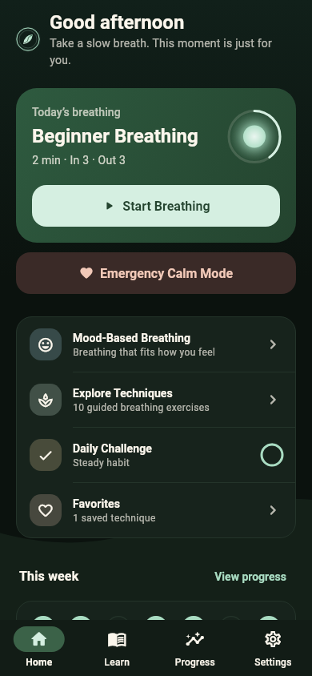
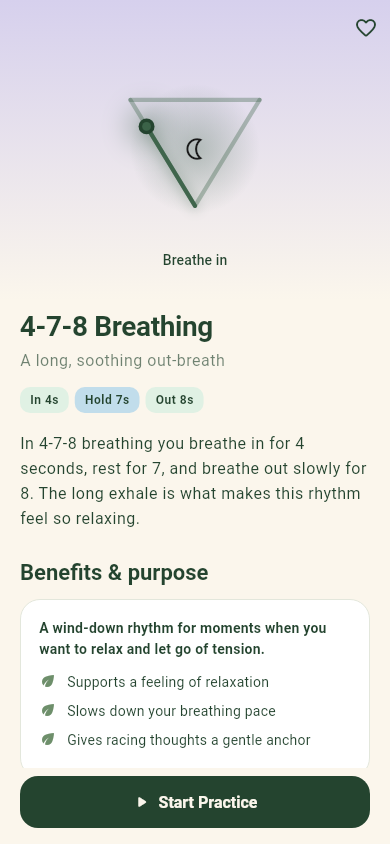
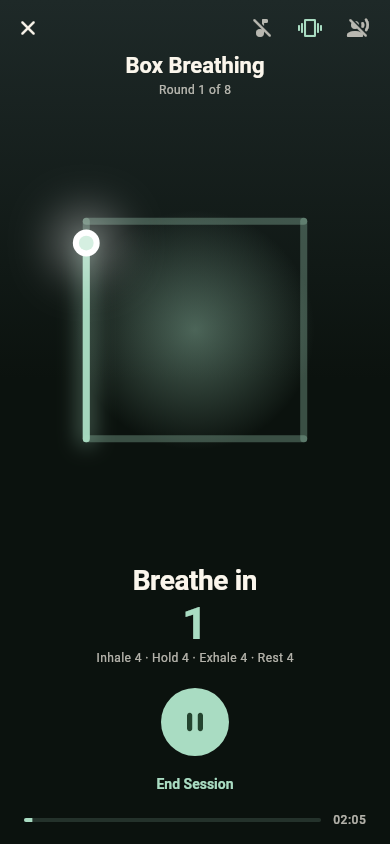
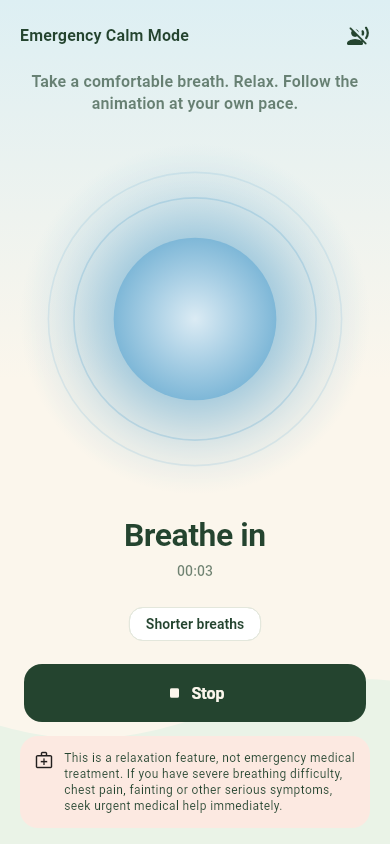

# BreatheCare 🌿

A peaceful, nature-inspired breathing & wellness app built with Flutter (Android & iOS).
Free, ad-supported (Google AdMob), English + Hindi, light & dark themes, and fully usable offline.

> BreatheCare is a relaxation / wellness app. It is **not** a medical device and makes no medical claims.

| Home | Home (more) | Home (dark) | Technique |
| --- | --- | --- | --- |
|  |  |  |  |
| **Guided session** | **Session (dark)** | **Emergency Calm** | |
|  |  |  | |

<sub>Screenshots are rendered from widget tests.</sub>

## Features

| Area | What's included |
| --- | --- |
| **Home** | Greeting, today's suggested technique with daily-goal ring, **Start Breathing**, **Emergency Calm Mode**, Explore / Mood / Daily Challenge / Favorites shortcuts, today's challenge, recently practiced, weekly summary |
| **Techniques** | 10 techniques (Beginner, Box, 4-7-8, Deep Belly, Pursed-Lip, Equal, Slow, Resonant, Gentle Relaxation, Focus) — each with description, benefits & purpose, steps, recommended duration, duration picker, live rhythm preview, audio guidance and **Start Practice** |
| **Guided session** | Animated lotus visual that grows/shrinks with the breath, Inhale / Hold (only where appropriate) / Exhale, phase countdown, elapsed & remaining time, Pause/Resume, End Session, optional voice guidance (on-device TTS, works offline), haptic cues, keeps screen awake, auto-pauses when the app is backgrounded. **Gentle mode** removes every breath hold. |
| **Mood-Based Breathing** | “How are you feeling right now?” popup with 8 moods → a page of suitable techniques with an explanation and Start Breathing button. Mood is never stored. |
| **Daily Challenges** | 7 rotating challenges, progress ring, completion status, challenge streak, 30-day completion rate, history of previous days. Computed from local history → works offline. |
| **Emergency Calm Mode** | Starts instantly, simple 4-in / 6-out breathing (no holds), large visual, reassuring rotating messages, “Shorter breaths” option, big **Stop** button, medical-help disclaimer, offline, never shows ads. |
| **Learn** | 8 illustrated articles (bilingual). |
| **Progress** | Total sessions/minutes, current & longest streak, today, weekly bar chart, 4-week activity heat-map, challenge completion, most practiced techniques, full session history. |
| **Favorites** | Heart any technique; dedicated Favorites screen. |
| **Audio guidance** | MP3s downloaded once from Firebase Storage, stored on device, played offline. Download progress, downloaded badge, retry, cancel, delete, delete-all, storage used. Player: Play/Pause, Replay, seek bar. |
| **Account (optional)** | Invited after ~10 days of use (max twice). User ID + PIN, Login / Create Account / Maybe Later. Back up & restore progress (Firestore). The app never requires login. |
| **Settings** | English / हिन्दी, Light / Dark / System theme, voice guidance & volume, haptics, gentle-mode default, downloaded audio management, account, Privacy Policy, Terms, About, ad privacy choices (when required), **Delete My Data**. |

## Advertising rules (enforced in `lib/services/ads_service.dart`)

* Only small, labelled **banner** ads (Home, Explore Techniques, Learn, Progress). No interstitial / full-screen ads.
* Ads are **suppressed** (banners disposed) whenever a breathing session or Emergency Calm Mode is open.
* All requests are `nonPersonalizedAds: true`, with no keywords — mood/wellness data is never used for targeting. Content rating is capped at **G**.
* Google UMP consent is requested where legally required; “Ad privacy choices” appears in Settings when needed.

## Getting started

```bash
flutter pub get
flutter run
```

The app runs immediately with Google's **test** ad units and without Firebase (cloud features then show a friendly “not available” message; everything else works offline).

### 1. AdMob

1. Create the app and a **Banner** ad unit in [AdMob](https://apps.admob.com).
2. Put your **ad unit IDs** in `lib/config/ad_config.dart`.
3. Put your **App IDs** in:
   * `android/app/src/main/AndroidManifest.xml` → `com.google.android.gms.ads.APPLICATION_ID`
   * `ios/Runner/Info.plist` → `GADApplicationIdentifier`
4. Debug builds always use Google's test ads.
5. (Recommended) add your full SKAdNetwork list to `Info.plist` from Google's docs, and create a GDPR message in AdMob › Privacy & messaging.

### 2. Firebase (login, backup, audio downloads)

```bash
dart pub global activate flutterfire_cli
flutterfire configure --out=lib/config/firebase_options.dart
```


In the Firebase console:

* **Authentication** → enable the **Email/Password** provider (User IDs are mapped internally to `<userid>@users.breathecare.app`; no real e-mail is collected).
* **Firestore** → create a database and deploy `firestore.rules`.
* **Storage** → deploy `storage.rules` and upload your MP3s to the `guidance/` folder using these names:

| Technique | File |
| --- | --- |
| Beginner Breathing | `guidance/beginner.mp3` |
| Box Breathing | `guidance/box.mp3` |
| 4-7-8 Breathing | `guidance/478.mp3` |
| Deep Belly Breathing | `guidance/belly.mp3` |
| Pursed-Lip Breathing | `guidance/pursed.mp3` |
| Equal Breathing | `guidance/equal.mp3` |
| Slow Breathing | `guidance/slow.mp3` |
| Resonant Breathing | `guidance/resonant.mp3` |
| Gentle Relaxation Breathing | `guidance/relax.mp3` |
| Focus Breathing | `guidance/focus.mp3` |

### 3. Download an APK from GitHub Actions

The **Build APK** workflow runs **only when you start it** (pushing code never triggers a build):

1. Open the repository on GitHub → **Actions** → **Build APK** → **Run workflow**.
2. Pick the branch, `release` or `debug`, and optionally *split per ABI* for smaller APKs.
3. When it finishes (~10 min), download the APK from **Artifacts** at the bottom of the run page (a zip containing the `.apk`).

Without signing secrets the release APK is signed with a debug key — fine for installing on your phone, but not for Google Play. To sign with your own key, create one:

```bash
keytool -genkey -v -keystore upload-keystore.jks -keyalg RSA -keysize 2048 -validity 10000 -alias upload
base64 -w0 upload-keystore.jks   # copy the output
```

and add repository secrets (**Settings → Secrets and variables → Actions**): `ANDROID_KEYSTORE_BASE64`, `ANDROID_KEYSTORE_PASSWORD`, `ANDROID_KEY_ALIAS`, `ANDROID_KEY_PASSWORD`. Keep the `.jks` file safe — you need the same key for every Play Store update.

### 4. Release

* Android: set your own `applicationId` in `android/app/build.gradle.kts` and a release signing config.
* iOS: set your bundle id / team in Xcode, then `cd ios && pod install`.

## Project structure

```
lib/
  main.dart, app.dart          app bootstrap, providers, theming, localization
  config/                      AdMob + Firebase configuration
  data/                        techniques, moods, challenges, articles, legal text (EN + HI)
  l10n/                        UI strings (EN + HI) and bilingual text helper
  models/                      breath pattern, technique, session, article
  services/                    progress store, challenges, breathing clock, ads, audio downloads,
                               account/backup, voice guidance, settings, usage tracking
  screens/                     all screens
  widgets/                     lotus breathing visual, nature background, banner slot, cards, charts
test/                          unit + widget tests (flutter test)
```

## Tests

```bash
flutter analyze
flutter test
```
